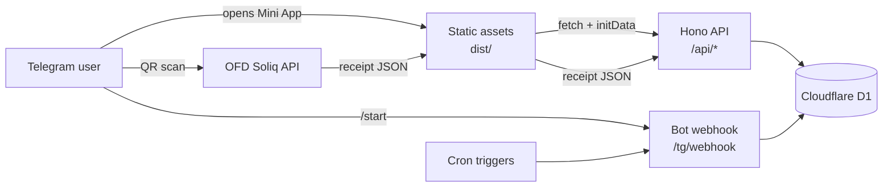

# Family Budget — Telegram Mini App

**English** · [Русский](README.ru.md)

[](https://github.com/alrevion/family-budget/actions/workflows/ci.yml)
[](LICENSE)
[](https://workers.cloudflare.com)
[](https://core.telegram.org/bots/webapps)

A shared family budget that lives inside Telegram: incomes and expenses, savings goals, surprise
purchases, reports, and QR-receipt scanning for Uzbek fiscal receipts (OFD Soliq). No accounts,
no subscriptions, no third-party analytics — the data stays in your own Cloudflare D1 database.

```bash
npm install
npm run setup
```

That is the whole installation. `npm run setup` creates the D1 database, applies migrations, sets
the secrets, deploys the Worker, and registers the Telegram webhook.

---

## Table of contents

1. [Features](#features)
2. [How it looks](#how-it-looks)
3. [Tech stack](#tech-stack)
4. [Deploy in 10 minutes](#deploy-in-10-minutes)
5. [Local development](#local-development)
6. [QR receipts](#qr-receipts)
7. [Architecture](#architecture)
8. [Project structure](#project-structure)
9. [API](#api)
10. [Data and migrations](#data-and-migrations)
11. [Tests](#tests)
12. [Security](#security)
13. [Troubleshooting](#troubleshooting)
14. [Adding a new module](#adding-a-new-module)
15. [License](#license)

---

## Features

- **Shared budget for the whole family.** Every Telegram account from `ALLOWED_IDS` sees the same
  data; every entry is signed with the author's name.
- **Five tabs:** Home (free money, savings, month spend), Feed, Goals, Shops, Report.
- **Savings goals.** Allocate money from “free” to a goal, return it back, archive the goal.
  Allocations are tracked separately, so the report never counts the same money twice.
- **Hidden expenses (“surprises”).** Hide an entry for 1 day / 1 week / 1 month / 6 months. The
  other person sees only “Hidden” and the amount — no category, no comment — until the date passes.
  The hiding period cannot be extended after saving.
- **Reports and comparisons.** Expenses/incomes by category, filters by category and author,
  comparison of two periods or two authors, month-by-month history.
- **QR receipts.** Press **+** → the camera opens immediately → scan the QR code from a paper
  receipt → amount, date, and shop are filled in automatically. See [QR receipts](#qr-receipts).
- **Shop memory.** A shop remembers the category of its last purchase. The next receipt from the
  same shop suggests it with a one-tap “Save to …” button. The category can be changed or forgotten
  in the **Shops** tab.
- **Bot notifications.** Monthly report on the 1st at 10:00 (Tashkent) and a gentle daily reminder
  if there were no entries for 3 days, with “add for day X” and “No spend today” buttons.
- **Allowlist only.** The API and the bot work exclusively for Telegram IDs listed in the
  `ALLOWED_IDS` secret. Everyone else gets `403`.
- **Serverless and cheap.** A Cloudflare Workers free plan is enough for a family: one Worker,
  one D1 database, no servers to maintain.

## How it looks

The Mini App follows Telegram theme colors (light and dark) and uses system fonts with a compact
numeric grid, so it feels native on iOS and Android. Screens: **Home** (free money, savings, month
spend), **Feed**, **Goals**, **Shops**, **Report**, and the **New entry** form with the receipt
scanner on top. The entry flow is built for speed: a numeric keypad, one-tap categories, and the
camera as the first action on **+**.

## Tech stack

| Layer | Choice | Why |
|---|---|---|
| Runtime | Cloudflare Workers | Free tier, global edge, zero servers |
| Database | Cloudflare D1 (SQLite) | Same platform, SQL, migrations as files |
| Backend | [Hono](https://hono.dev) 4 + TypeScript | Tiny router, Web-standard `Request`/`Response` |
| Frontend | TypeScript, no framework | ~15 kB of hand-written DOM code, no build step beyond `tsc` |
| Tests | Vitest in the real `workerd` runtime | Same runtime as production, real D1 binding |
| Bot | Telegram Bot API webhook | No polling process, no extra hosting |

## Deploy in 10 minutes

### 1. Create the bot

1. Open [@BotFather](https://t.me/BotFather) → `/newbot` → get the **token** (`123456789:AA…`) and
   the bot **username**.
2. Optional: `/newapp` → choose the bot → paste the Worker URL (you will get it during setup) →
   get the Mini App **short name**. Without it the app still opens from the bot button; the short
   name only enables `t.me/<bot>/<app>` links and `?startapp=` deep links.
3. Optional: `/setmenubutton` → the same URL, so the app opens from the chat menu.

### 2. Run the installer

Requirements: **Node.js 20+** and a Cloudflare account (the free plan is enough).

```bash
git clone https://github.com/alrevion/family-budget.git
cd family-budget
npm install
npm run setup
```

The script asks for two things:

| Prompt | Where to get it |
|---|---|
| `BOT_TOKEN` | BotFather → `/newbot` or `/token` |
| `ALLOWED_IDS` | your Telegram ID(s) from [@userinfobot](https://t.me/userinfobot), comma-separated |

Then it does everything itself:

1. `wrangler login` (opens the browser if you are not logged in);
2. creates the `family-budget-db` D1 database (or reuses it) and writes `database_id` into
   `wrangler.toml`;
3. applies the migrations to the **remote** database;
4. builds the frontend and deploys the Worker;
5. writes `BOT_USERNAME`, `MINI_APP_URL` and `MINI_APP_SHORT_NAME` into `wrangler.toml`;
6. puts the secrets `BOT_TOKEN`, `WEBHOOK_SECRET`, `ALLOWED_IDS` into the Worker;
7. registers the webhook and the “Бюджет” menu button.

Preview the plan without changing anything:

```bash
npm run setup -- --dry-run
```

### 3. Check

```bash
curl https://family-budget.<your-subdomain>.workers.dev/api/health
# {"ok":true}
```

Open the bot → `/start` → **Открыть приложение**. The first launch asks for the starting balance.

> **Windows:** the installer and the build use only Node.js APIs, so no Git Bash or WSL is needed.

### Manual deployment

<details>
<summary>If you prefer to run the steps yourself</summary>

```bash
npx wrangler login
npx wrangler d1 create family-budget-db          # copy database_id into wrangler.toml
npx wrangler d1 migrations apply family-budget-db --remote
npx wrangler secret put BOT_TOKEN
npx wrangler secret put WEBHOOK_SECRET           # openssl rand -hex 32
npx wrangler secret put ALLOWED_IDS              # 111111111,222222222
npm run build && npm run deploy
```

Then set the webhook (the token and the URL are yours):

```bash
curl "https://api.telegram.org/bot<BOT_TOKEN>/setWebhook" \
  -d "url=https://family-budget.<subdomain>.workers.dev/tg/webhook" \
  -d "secret_token=<WEBHOOK_SECRET>" \
  -d 'allowed_updates=["message"]'
```

</details>

### Updating a deployed instance

```bash
npm run check
npx wrangler d1 migrations apply family-budget-db --remote   # only if new migrations
npm run build && npm run deploy
```

`npm run deploy` does **not** build the frontend — always run `npm run build` first (or use
`npm run check && npm run build && npm run deploy`).

## Local development

```bash
npm install
```

Create `.dev.vars` (git-ignored) with test secrets:

```ini
BOT_TOKEN=123456789:TEST_TOKEN_NOT_REAL
WEBHOOK_SECRET=local-dev-secret
ALLOWED_IDS=111111111,222222222
```

```bash
npm run migrate   # local D1
npm run build
npm run dev       # http://localhost:8787
```

`curl http://localhost:8787/api/health` → `{"ok":true}`.

Opening the Mini App in a normal browser does not work fully: without Telegram there is no
`initData`, so the API answers `401` and the app shows “Session expired”. Use tests, Telegram
itself, or a tunnel (`cloudflared tunnel --url http://localhost:8787`) with a temporary BotFather
URL.

## QR receipts

The app supports **OFD Soliq** receipts (`https://ofd.soliq.uz/check?...`) — most Uzbek fiscal
receipts, including EPI. The OFD web page is never loaded or scraped.

1. The QR code contains `t` (cash register), `r` (receipt number), `c` (date) and `s`/`h`
   (fiscal sign / EPI hash).
2. The request to the public JSON API `new-ofd.soliq.uz` is signed with HMAC-SHA256. **The phone
   signs and sends it** (`app/src/ofd-direct.ts`): from the Cloudflare edge `new-ofd.soliq.uz`
   times out (OFD blocks datacenter IPs), while from Uzbekistan OFD allows the cross-origin call.
   The Worker (`src/ofd.ts`) stays as a fallback and retries the request if the direct call fails.
   The signing key is not a project secret — it ships in OFD's own public JavaScript bundle.
3. The server parses the response with the same code it would use for its own request: the total
   (`Jami to'lov` → `cashTotal + cardTotal`), the date, and the shop name without the legal
   suffix (`«ANGLESEY FOOD» MAS'ULIYATI…` → `ANGLESEY FOOD`). The client never writes to the
   database: caching and shop memory live only in D1.
4. A recognised receipt is cached in `receipts`, so scanning the same QR again does not hit OFD.
   Deleting the expense deletes its receipt too — the same QR can be recorded again.
5. One receipt cannot be saved twice: a unique key over `terminal_id + payment_no + payment_date`
   plus a check when the expense is created. Refund receipts are not supported yet.

If the receipt is not in OFD yet, the service is down, or the QR is not from Soliq, the app shows
a clear error and keeps manual entry fully working.

## Architecture



- Static files are served by Workers Static Assets straight from `dist/`; the Worker is invoked
  first only for `/api/*` and `/tg/webhook`.
- Every API request carries `Authorization: tma <initData>`; the Worker verifies the Telegram
  HMAC signature, checks `auth_date` (24 h), checks the allowlist, and only then touches D1.
- Hidden-expense masking lives in exactly one module (`src/queries/masking.ts`), so no endpoint
  can accidentally leak a hidden category or comment.
- SQL lives only in `src/queries/*`; HTTP validation lives only in `src/api/*`.

## Project structure

```
src/                     Worker (backend)
├── index.ts             Entry point: /api/health, /tg/webhook, /api/*, cron
├── auth.ts              Telegram initData verification + allowlist
├── bot.ts               Bot webhook, messages, app buttons
├── cron.ts              Monthly report and daily reminder
├── ofd.ts               QR parsing, HMAC signing, OFD receipt fetch + normalization
├── time.ts, money.ts    Asia/Tashkent dates, money formatting
├── api/                 HTTP routes by domain (validation at the boundary)
│   ├── index.ts         Auth middleware + route groups
│   ├── validate.ts      readBody, parseId, isName, shared validators
│   └── transactions.ts, categories.ts, goals.ts, reports.ts, receipts.ts, shops.ts, state.ts
└── queries/             All D1 access (SQL only here)
    ├── index.ts         Single re-export module "queries"
    ├── shops.ts         Shops, receipts, category memory, stats
    └── masking.ts       Hidden-expense masking (only place)

app/                     Mini App (frontend)
├── index.html, styles.css, icon.svg, _headers
└── src/
    ├── main.ts          Boot, deep links, tab switching
    ├── nav.ts           Bottom navigation
    ├── receipt-scanner.ts  Receipt block inside the new-entry form
    ├── ofd-direct.ts    Direct OFD request from the phone
    ├── api.ts           Single network entry point + human error texts
    ├── api-types.ts     Response types
    └── screens/         home, feed, goals, shops, report, …

migrations/              D1 SQL migrations (0001_*.sql, …) + drop.sql
scripts/                 setup.mjs (installer), build.mjs (static build)
tests/                   Vitest tests running inside workerd
wrangler.toml            Worker config: D1, cron, public vars, assets
```

## API

All routes except `/api/health` require the `Authorization: tma <initData>` header and an
allowlisted Telegram ID. Errors are `{ "error": "<code>" }`.

| Method | Path | Purpose |
|---|---|---|
| `GET` | `/api/health` | Liveness probe (no auth) |
| `GET` | `/api/balance` | Free money, savings, month totals |
| `GET` | `/api/transactions?month=YYYY-MM` | Month feed |
| `POST` `PATCH` `DELETE` | `/api/transactions[/:id]` | Create / edit / delete an entry (optionally linked to a receipt) |
| `GET` `POST` `PATCH` `DELETE` | `/api/categories[/:id]` | Categories, archive, rename |
| `GET` `POST` `DELETE` | `/api/goals[/:id]` | Savings goals |
| `POST` | `/api/goals/:id/allocate` `/deallocate` | Move money to/from a goal |
| `GET` | `/api/report`, `/api/compare`, `/api/months` | Reports, period/author comparison, history |
| `POST` | `/api/receipts/lookup` | Resolve a QR receipt, cache it, suggest a category |
| `GET` `PATCH` | `/api/shops[/:id]` | Shops and their remembered category |
| `GET` `PUT` | `/api/state/:key`, `/api/state/quiet` | App state (onboarding, quiet mode) |
| `GET` | `/api/users` | Family members for the feed signature |

## Data and migrations

Eight tables: `users`, `categories`, `transactions`, `goals`, `goal_allocations`, `app_state`,
`shops`, `receipts`.

- `migrations/0001_init.sql` … `0003_shops_receipts.sql` — schema, applied in order.
- `migrations/drop.sql` is **not** a migration: `migrations_pattern` in `wrangler.toml` matches
  only `NNNN_*.sql`, so `drop.sql` runs only when you ask for it explicitly.

```bash
npx wrangler d1 migrations apply family-budget-db --remote   # production
npm run migrate                                              # local
npx wrangler d1 execute family-budget-db --remote --command "SELECT name FROM sqlite_master"
```

> Always apply migrations **before** deploying code that uses the new schema.

## Tests

```bash
npm test     # vitest run
npm run check  # tsc (worker + app) + tests
```

Tests run in the real `workerd` runtime via `@cloudflare/vitest-pool-workers`, with a real D1
binding. They cover authentication (including an externally generated initData vector), privacy of
hidden expenses, balance math, goals, reports, receipts, and shops. No network calls to Telegram or
OFD are made in tests.

## Security

The short version:

- **No secrets in the repository.** The bot token, webhook secret, and allowlist are Worker
  secrets, set by `npm run setup` or `wrangler secret put`. `.dev.vars` and `.env*` are git-ignored.
- **Every API call is authenticated** with Telegram's `initData` HMAC-SHA256 signature, a 24-hour
  freshness window, and an ID allowlist checked before any D1 access.
- **The webhook checks** the `X-Telegram-Bot-Api-Secret-Token` header and always answers `200` so
  Telegram does not retry.
- **No CORS wildcard.** The API is same-origin only; the frontend talks to its own Worker.
- **Strict CSP and security headers** for static assets (`app/_headers`): `default-src 'self'`,
  scripts only from the same origin and `telegram.org`, connections only to the API and
  `new-ofd.soliq.uz`, framing allowed only for Telegram.
- **No `innerHTML` with user data.** The UI builds nodes with `textContent`; raw HTML is used only
  for static SVG icons and charts.
- **Parameterized SQL everywhere**, no string concatenation with user input.
- **Hidden expenses are masked** in one place, so reports and comparisons cannot leak them.
- The OFD signing key is **public by design** (it ships in OFD's own web client). It only allows
  reading a receipt by its QR parameters, which is exactly what the official site does.

The full threat model, reporting instructions, and the notes about dev-only `npm audit`
advisories are in [SECURITY.md](SECURITY.md).

## Troubleshooting

| Symptom | Cause | Fix |
|---|---|---|
| App shows “Session expired” | Opened outside Telegram or `initData` is older than 24 h | Open from the bot button; do not reload a stale tab |
| `403 forbidden` | Your Telegram ID is not in `ALLOWED_IDS` | `npx wrangler secret put ALLOWED_IDS` with your ID |
| `/api/health` returns HTML | Assets caught `/api/*` | Check `run_worker_first = ["/api/*", "/tg/webhook"]` in `wrangler.toml` |
| Bot does not answer `/start` | Webhook is not set or the secret does not match | Re-run `npm run setup` (idempotent) or `setWebhook` manually |
| “Receipt not found / not processed yet” | The receipt is not in OFD yet (fresh purchase) or it is a refund | Wait a couple of minutes and scan again; refunds are entered manually |
| “Receipt service is unavailable” | Neither the phone nor the Worker could reach OFD | Check mobile internet; retry later |
| `database_id` error on deploy | `wrangler.toml` still has the template ID | Run `npm run setup` or paste the ID from `wrangler d1 list` |
| Changes do not appear after deploy | `dist/` was not rebuilt | `npm run build && npm run deploy` |
| Cron messages arrive at the wrong time | Cron is UTC | `0 5 * * *` = 10:00 Asia/Tashkent |

More details: `npx wrangler tail` for live Worker logs, `npx wrangler d1 migrations list
family-budget-db --remote` for migration status.

## Adding a new module

The project follows one vertical slice per feature. For a “Subscriptions” module:

1. **Migration** — `migrations/0004_subscriptions.sql`; keep `NNNN_` numbering.
2. **Queries** — `src/queries/subscriptions.ts`, re-export from `src/queries/index.ts`; all SQL
   and only SQL lives here.
3. **API** — `src/api/subscriptions.ts`, mount it in `src/api/index.ts` after the auth middleware;
   validate the body with `readBody`/`parseId` and return `{ error: "<code>" }` codes.
4. **Frontend** — types in `app/src/api-types.ts`, calls in `app/src/api.ts` (the only network
   entry point), a screen in `app/src/screens/`, a tab in `app/src/nav.ts`.
5. **Cron** — if the module needs a schedule, dispatch by `controller.cron` in `src/cron.ts` and
   add the expression to `[triggers]` in `wrangler.toml` (UTC).
6. **Secrets/vars** — a secret via `wrangler secret put`, a public value in `[vars]`.
7. **Tests** — `tests/subscriptions.test.ts` using the existing helpers.

Run `npm run check` before committing.

## License

[MIT](LICENSE). Use it, fork it, run it for your own family.

---

Made for a two-person household in Tashkent. If you find a bug or want a feature, open an issue.
