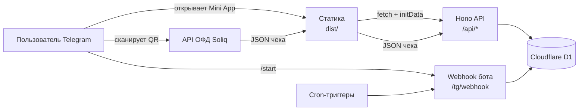

# Семейный бюджет — Telegram Mini App

[English](README.md) · **Русский**

[](https://github.com/alrevion/family-budget/actions/workflows/ci.yml)
[](LICENSE)
[](https://workers.cloudflare.com)
[](https://core.telegram.org/bots/webapps)

Общий бюджет семьи прямо в Telegram: доходы и расходы, цели накоплений, скрытые траты
(«сюрпризы»), отчёты и сканирование бумажных чеков ОФД Soliq по QR. Без регистрации, подписок и
сторонней аналитики — данные лежат в вашей собственной базе Cloudflare D1.

```bash
npm install
npm run setup
```

Это вся установка. `npm run setup` создаёт базу D1, применяет миграции, прописывает секреты,
деплоит Worker и регистрирует webhook Telegram.

---

## Содержание

1. [Возможности](#возможности)
2. [Стек](#стек)
3. [Установка за 10 минут](#установка-за-10-минут)
4. [Локальный запуск](#локальный-запуск)
5. [Чеки по QR](#чеки-по-qr)
6. [Архитектура](#архитектура)
7. [Структура проекта](#структура-проекта)
8. [API](#api)
9. [Данные и миграции](#данные-и-миграции)
10. [Тесты](#тесты)
11. [Безопасность](#безопасность)
12. [Возможные ошибки](#возможные-ошибки)
13. [Как дописать новый модуль](#как-дописать-новый-модуль)
14. [Лицензия](#лицензия)

---

## Возможности

- **Общий бюджет на всю семью.** Все аккаунты из `ALLOWED_IDS` видят одни и те же данные,
  каждая запись подписана именем автора.
- **Пять вкладок:** Главная (свободно, в целях, траты за месяц), Лента, Цели, Магазины, Отчёт.
- **Цели накоплений.** Отложить деньги из «Свободно» в цель, вернуть обратно, архивировать.
  Отложенное учитывается отдельно, поэтому отчёт не считает одни и те же деньги дважды.
- **Скрытые траты.** Запись можно скрыть на 1 день / неделю / месяц / полгода. Второй человек
  видит только сумму под меткой «Скрытое», без категории и комментария, пока срок не выйдет.
  Удобно для подарков; продлить срок после сохранения нельзя.
- **Отчёты и сравнения.** Расходы и доходы по категориям, фильтры по категориям и авторам,
  сравнение двух периодов или двух авторов, история по месяцам.
- **Чеки по QR.** Нажали **+** — камера открылась сразу — навели на QR с бумажного чека — сумма,
  дата и магазин подставились сами. Подробности — в разделе [Чеки по QR](#чеки-по-qr).
- **Память магазина.** Магазин запоминает категорию последней покупки. Следующий чек из этого
  магазина предлагает её кнопкой «Сохранить в …». Категорию можно поменять или забыть во вкладке
  **Магазины**.
- **Сообщения от бота.** Отчёт за прошлый месяц 1-го числа в 10:00 (Ташкент) и ежедневное
  напоминание, если 3 дня не было записей, с кнопками «добавить за день X» и «Ничего не тратили».
- **Только для своих.** API и бот работают исключительно для Telegram ID из секрета
  `ALLOWED_IDS`. Остальные получают `403`.
- **Serverless и дешёво.** Бесплатного тарифа Cloudflare Workers хватает семье: один Worker, одна
  база D1, ни одного сервера в обслуживании.

## Стек

| Слой | Выбор | Почему |
|---|---|---|
| Runtime | Cloudflare Workers | Бесплатный тариф, глобальный edge, нет серверов |
| База | Cloudflare D1 (SQLite) | Та же платформа, SQL, миграции файлами |
| Бэкенд | [Hono](https://hono.dev) 4 + TypeScript | Маленький роутер, стандартные `Request`/`Response` |
| Фронтенд | TypeScript без фреймворка | ~15 КБ рукописного DOM-кода, сборка — только `tsc` |
| Тесты | Vitest в реальном `workerd` | Тот же рантайм, что в проде, настоящий биндинг D1 |
| Бот | Webhook Telegram Bot API | Никакого polling-процесса и отдельного хостинга |

## Установка за 10 минут

### 1. Бот в BotFather

1. Откройте [@BotFather](https://t.me/BotFather) → `/newbot` → получите **токен**
   (`123456789:AA…`) и **username** бота.
2. Необязательно: `/newapp` → выберите бота → вставьте URL Worker'а (появится во время
   установки) → получите **short name**. Без него приложение всё равно открывается кнопкой из
   бота; short name нужен только для ссылок `t.me/<бот>/<приложение>` и `?startapp=`.
3. Необязательно: `/setmenubutton` → тот же URL, чтобы приложение открывалось из меню чата.

### 2. Запуск установщика

Нужны **Node.js 20+** и аккаунт Cloudflare (бесплатного тарифа достаточно).

```bash
git clone https://github.com/alrevion/family-budget.git
cd family-budget
npm install
npm run setup
```

Скрипт спросит всего две вещи:

| Вопрос | Где взять |
|---|---|
| `BOT_TOKEN` | BotFather → `/newbot` или `/token` |
| `ALLOWED_IDS` | ваш Telegram ID из [@userinfobot](https://t.me/userinfobot), через запятую |

Дальше он всё делает сам:

1. `wrangler login` (откроет браузер, если вы ещё не вошли);
2. создаёт базу `family-budget-db` (или берёт существующую) и прописывает `database_id` в
   `wrangler.toml`;
3. применяет миграции к **боевой** базе;
4. собирает фронтенд и деплоит Worker;
5. записывает `BOT_USERNAME`, `MINI_APP_URL` и `MINI_APP_SHORT_NAME` в `wrangler.toml`;
6. кладёт секреты `BOT_TOKEN`, `WEBHOOK_SECRET`, `ALLOWED_IDS` в Worker;
7. регистрирует webhook и кнопку меню «Бюджет».

Посмотреть план, ничего не меняя:

```bash
npm run setup -- --dry-run
```

### 3. Проверка

```bash
curl https://family-budget.<ваш-сабдомен>.workers.dev/api/health
# {"ok":true}
```

Откройте бота → `/start` → **Открыть приложение**. При первом запуске приложение попросит
стартовый остаток.

> **Windows:** установщик и сборка используют только Node.js, поэтому Git Bash или WSL не нужны.

### Деплой вручную

<details>
<summary>Если хотите пройти шаги сами</summary>

```bash
npx wrangler login
npx wrangler d1 create family-budget-db          # database_id скопировать в wrangler.toml
npx wrangler d1 migrations apply family-budget-db --remote
npx wrangler secret put BOT_TOKEN
npx wrangler secret put WEBHOOK_SECRET           # openssl rand -hex 32
npx wrangler secret put ALLOWED_IDS              # 111111111,222222222
npm run build && npm run deploy
```

Затем webhook (токен и URL — ваши):

```bash
curl "https://api.telegram.org/bot<BOT_TOKEN>/setWebhook" \
  -d "url=https://family-budget.<сабдомен>.workers.dev/tg/webhook" \
  -d "secret_token=<WEBHOOK_SECRET>" \
  -d 'allowed_updates=["message"]'
```

</details>

### Обновление уже задеплоенного

```bash
npm run check
npx wrangler d1 migrations apply family-budget-db --remote   # только если есть новые миграции
npm run build && npm run deploy
```

`npm run deploy` **не собирает** фронтенд — сначала `npm run build` (или одной строкой
`npm run check && npm run build && npm run deploy`).

## Локальный запуск

```bash
npm install
```

Создайте `.dev.vars` (в git не попадает) с тестовыми секретами:

```ini
BOT_TOKEN=123456789:TEST_TOKEN_NOT_REAL
WEBHOOK_SECRET=local-dev-secret
ALLOWED_IDS=111111111,222222222
```

```bash
npm run migrate   # локальная D1
npm run build
npm run dev       # http://localhost:8787
```

`curl http://localhost:8787/api/health` → `{"ok":true}`.

Полноценно открыть Mini App в обычном браузере не получится: без Telegram нет `initData`, API
вернёт `401`, и приложение покажет «Сессия устарела». Проверяйте тестами, в самом Telegram или
через туннель (`cloudflared tunnel --url http://localhost:8787`) с временным URL в BotFather.

## Чеки по QR

Приложение поддерживает чеки **ОФД Soliq** (`https://ofd.soliq.uz/check?...`) — большинство
фискальных чеков Узбекистана, включая EPI. Страница ОФД не загружается и не парсится.

1. В QR-коде лежат `t` (ККМ), `r` (номер чека), `c` (дата) и `s`/`h` (фискальный признак / хеш EPI).
2. Запрос к публичному JSON API `new-ofd.soliq.uz` подписывается HMAC-SHA256. **Подписывает и
   отправляет его телефон** (`app/src/ofd-direct.ts`): с edge Cloudflare `new-ofd.soliq.uz` не
   отвечает (ОФД режет датацентровые IP), а из Узбекистана CORS ОФД разрешает прямой запрос.
   Worker (`src/ofd.ts`) остаётся запасным путём и повторяет запрос, если прямой не удался. Ключ
   подписи не секрет проекта — он лежит в открытом JS-бандле самого ОФД.
3. Сервер разбирает ответ тем же кодом, что и для своего запроса: итог (`Jami to'lov` →
   `cashTotal + cardTotal`), дату и название магазина без юридической обвязки
   (``«ANGLESEY FOOD» MAS`ULIYATI…`` → `ANGLESEY FOOD`). Клиент ничего не пишет в базу: кеш и
   память магазинов живут только в D1.
4. Распознанный чек кешируется в `receipts`: повторный скан того же QR не ходит в ОФД. Удаление
   траты удаляет и чек, поэтому тот же QR можно записать заново.
5. Один чек нельзя записать дважды — уникальный ключ `terminal_id + payment_no + payment_date` и
   проверка при сохранении траты. Чеки возврата пока не поддерживаются.

Если чек ещё не появился в ОФД, сервис недоступен или QR не от Soliq, приложение показывает
понятную ошибку, а ручной ввод продолжает работать полностью.

## Архитектура



- Статику отдают Workers Static Assets прямо из `dist/`; Worker вызывается первым только для
  `/api/*` и `/tg/webhook`.
- Каждый запрос к API несёт `Authorization: tma <initData>`; Worker проверяет подпись Telegram,
  свежесть `auth_date` (24 ч), allowlist — и только потом идёт в D1.
- Маскирование скрытых трат живёт ровно в одном модуле (`src/queries/masking.ts`), поэтому ни
  один эндпоинт не может случайно выдать скрытую категорию или комментарий.
- SQL живёт только в `src/queries/*`, валидация HTTP — только в `src/api/*`.

## Структура проекта

```
src/                     Worker (бэкенд)
├── index.ts             Вход: /api/health, /tg/webhook, /api/*, cron
├── auth.ts              Проверка initData Telegram + allowlist
├── bot.ts               Webhook бота, сообщения, кнопки приложения
├── cron.ts              Месячный отчёт и ежедневное напоминание
├── ofd.ts               Разбор QR, подпись, запрос и нормализация чека ОФД
├── time.ts, money.ts    Даты Asia/Tashkent, форматирование сумм
├── api/                 HTTP-маршруты по доменам (валидация на границе)
│   ├── index.ts         Auth-middleware + подключение групп
│   ├── validate.ts      readBody, parseId, isName, общие валидаторы
│   └── transactions.ts, categories.ts, goals.ts, reports.ts, receipts.ts, shops.ts, state.ts
└── queries/             Вся работа с D1 (SQL только здесь)
    ├── index.ts         Единый реэкспорт "queries"
    ├── shops.ts         Магазины, чеки, память категорий, статистика
    └── masking.ts       Маскирование скрытых трат (единственное место)

app/                     Mini App (фронтенд)
├── index.html, styles.css, icon.svg, _headers
└── src/
    ├── main.ts          Запуск, deep-link'и, переключение вкладок
    ├── nav.ts           Нижняя навигация
    ├── receipt-scanner.ts  Блок «Чек из магазина» в форме записи
    ├── ofd-direct.ts    Прямой запрос чека в ОФД с телефона
    ├── api.ts           Единственная точка сети + человеческие тексты ошибок
    ├── api-types.ts     Типы ответов
    └── screens/         home, feed, goals, shops, report, …

migrations/              SQL-миграции D1 (0001_*.sql, …) + drop.sql
scripts/                 setup.mjs (установщик), build.mjs (сборка статики)
tests/                   Тесты Vitest в рантайме workerd
wrangler.toml            Конфиг Worker'а: D1, cron, публичные переменные, assets
```

## API

Все маршруты, кроме `/api/health`, требуют заголовок `Authorization: tma <initData>` и
Telegram ID из allowlist. Ошибки — `{ "error": "<code>" }`.

| Метод | Путь | Назначение |
|---|---|---|
| `GET` | `/api/health` | Проверка живости (без auth) |
| `GET` | `/api/balance` | Свободно, в целях, итоги месяца |
| `GET` | `/api/transactions?month=YYYY-MM` | Лента месяца |
| `POST` `PATCH` `DELETE` | `/api/transactions[/:id]` | Создать / изменить / удалить запись (можно с чеком) |
| `GET` `POST` `PATCH` `DELETE` | `/api/categories[/:id]` | Категории, архив, переименование |
| `GET` `POST` `DELETE` | `/api/goals[/:id]` | Цели накоплений |
| `POST` | `/api/goals/:id/allocate` `/deallocate` | Отложить в цель / вернуть |
| `GET` | `/api/report`, `/api/compare`, `/api/months` | Отчёты, сравнение периодов и авторов, история |
| `POST` | `/api/receipts/lookup` | Разобрать чек по QR, закешировать, подсказать категорию |
| `GET` `PATCH` | `/api/shops[/:id]` | Магазины и их запомненная категория |
| `GET` `PUT` | `/api/state/:key`, `/api/state/quiet` | Состояние приложения (онбординг, тишина) |
| `GET` | `/api/users` | Члены семьи для подписи в ленте |

## Данные и миграции

Восемь таблиц: `users`, `categories`, `transactions`, `goals`, `goal_allocations`, `app_state`,
`shops`, `receipts`.

- `migrations/0001_init.sql` … `0003_shops_receipts.sql` — схема, применяется по порядку.
- `migrations/drop.sql` — **не** миграция: `migrations_pattern` в `wrangler.toml` ловит только
  `NNNN_*.sql`, поэтому `drop.sql` выполняется лишь по явной команде.

```bash
npx wrangler d1 migrations apply family-budget-db --remote   # прод
npm run migrate                                              # локально
npx wrangler d1 execute family-budget-db --remote --command "SELECT name FROM sqlite_master"
```

> Миграции применяйте **до** деплоя кода, который использует новую схему.

## Тесты

```bash
npm test       # vitest run
npm run check  # tsc (worker + app) + тесты
```

Тесты идут в настоящем `workerd` через `@cloudflare/vitest-pool-workers` с реальным биндингом D1.
Покрыты: аутентификация (включая внешний вектор initData), приватность скрытых трат, математика
баланса, цели, отчёты, чеки и магазины. Сетевых запросов к Telegram и ОФД в тестах нет.

## Безопасность

Коротко:

- **В репозитории нет секретов.** Токен бота, webhook-секрет и allowlist — секреты Worker'а,
  задаются `npm run setup` или `wrangler secret put`. `.dev.vars` и `.env*` в `.gitignore`.
- **Каждый запрос к API аутентифицирован** подписью `initData` Telegram (HMAC-SHA256), окном
  свежести 24 часа и allowlist, который проверяется до любого обращения к D1.
- **Webhook проверяет** заголовок `X-Telegram-Bot-Api-Secret-Token` и всегда отвечает `200`,
  чтобы Telegram не повторял доставку.
- **Нет CORS-wildcard.** API работает только на своём origin, фронтенд ходит в свой же Worker.
- **Строгий CSP и security-заголовки** для статики (`app/_headers`): скрипты только свои и
  `telegram.org`, соединения только к API и `new-ofd.soliq.uz`, встраивание — только Telegram.
- **Никакого `innerHTML` с пользовательскими данными.** Интерфейс строит узлы через
  `textContent`; сырой HTML используется только для статических SVG-иконок и графиков.
- **Параметризованный SQL** везде, без склейки строк с пользовательским вводом.
- **Скрытые траты маскируются** в одном месте, поэтому отчёты и сравнения их не выдают.
- Ключ подписи ОФД **публичен по своей природе** (он есть в веб-клиенте ОФД) и позволяет лишь
  прочитать чек по параметрам его QR — ровно то, что делает официальный сайт.

Полная модель угроз, как сообщить об уязвимости и пояснения про `npm audit` (предупреждения
только в dev-зависимостях) — в [SECURITY.md](SECURITY.md).

## Возможные ошибки

| Симптом | Причина | Что делать |
|---|---|---|
| «Сессия устарела» | Открыли вне Telegram или `initData` старше 24 ч | Открывать кнопкой из бота; не перезагружать старую вкладку |
| `403 forbidden` | Вашего Telegram ID нет в `ALLOWED_IDS` | `npx wrangler secret put ALLOWED_IDS` со своим ID |
| `/api/health` отдаёт HTML | Статика перехватила `/api/*` | Проверьте `run_worker_first = ["/api/*", "/tg/webhook"]` в `wrangler.toml` |
| Бот молчит на `/start` | Webhook не установлен или не совпал секрет | Повторный `npm run setup` (идемпотентен) или `setWebhook` вручную |
| «Чек не найден / ещё не обработан» | Чек только что пробит и не появился в ОФД, либо это возврат | Подождать пару минут и отсканировать снова; возврат внести вручную |
| «Сервис чеков сейчас недоступен» | Ни телефон, ни Worker не достучались до ОФД | Проверить мобильный интернет; повторить позже |
| Ошибка `database_id` при деплое | В `wrangler.toml` остался шаблонный ID | `npm run setup` или вставить ID из `wrangler d1 list` |
| После деплоя ничего не изменилось | `dist/` не пересобран | `npm run build && npm run deploy` |
| Cron приходит не вовремя | Cron живёт в UTC | `0 5 * * *` = 10:00 Asia/Tashkent |

Подробнее: `npx wrangler tail` — живые логи Worker'а, `npx wrangler d1 migrations list
family-budget-db --remote` — статус миграций.

## Как дописать новый модуль

Проект собран вертикальными срезами: одна фича — один набор файлов. Для модуля «Подписки»:

1. **Миграция** — `migrations/0004_subscriptions.sql`, нумерация `NNNN_` обязательна.
2. **Запросы** — `src/queries/subscriptions.ts`, реэкспорт из `src/queries/index.ts`; весь SQL и
   только SQL живёт здесь.
3. **API** — `src/api/subscriptions.ts`, подключить в `src/api/index.ts` после auth-middleware;
   валидировать тело через `readBody`/`parseId`, ошибки — кодом `{ error: "<code>" }`.
4. **Фронтенд** — типы в `app/src/api-types.ts`, вызовы в `app/src/api.ts` (единственная точка
   сети), экран в `app/src/screens/`, вкладка в `app/src/nav.ts`.
5. **Cron** — если нужен график, диспетчеризация по `controller.cron` в `src/cron.ts` и
   выражение в `[triggers]` в `wrangler.toml` (UTC).
6. **Секреты/переменные** — секрет через `wrangler secret put`, публичное значение в `[vars]`.
7. **Тесты** — `tests/subscriptions.test.ts` на существующих хелперах.

Перед коммитом — `npm run check`.

## Лицензия

[MIT](LICENSE). Пользуйтесь, форкайте, ведите бюджет своей семьи.

---

Сделано для семьи из двух человек в Ташкенте. Нашли баг или хотите функцию — откройте issue.
